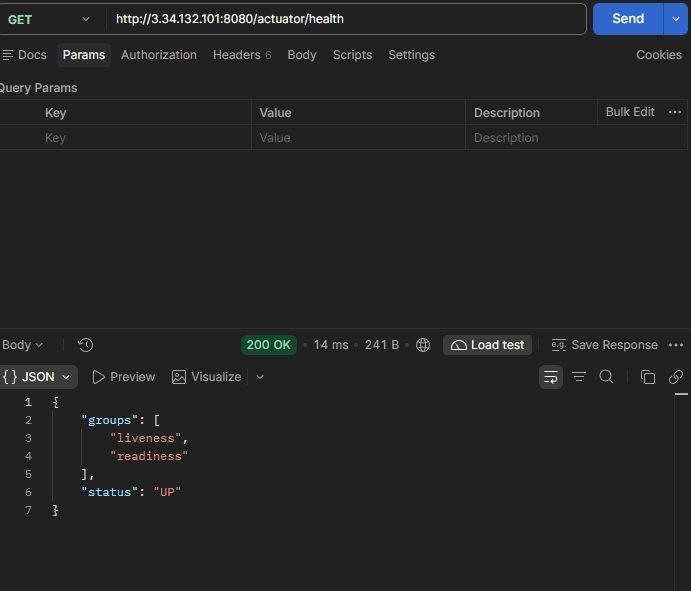
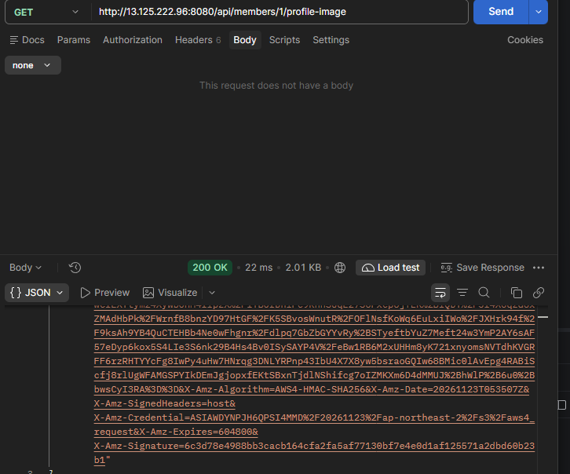

# Cloud Chap Task

## 1. 프로젝트 소개

AWS 클라우드 환경에서 Spring Boot 기반의 팀원 정보 등록 및 조회 API를 구현하고 배포하는 프로젝트입니다.

## 2. 기술 스택

- **Language** : Java 17
- **Framework** : Spring Boot, Spring Web MVC
- **Database** : H2, MySQL 
- **ORM** : Spring Data JPA
- **Library** : Lombok, Validation
- **Logging** : SLF4J
- **Monitoring** : Spring Boot Actuator
- **Build Tool** : Gradle
- **Infrastructure** : AWS VPC, EC2, RDS, S3
- **Version Control** : Git, GitHub
- **AWS Integration** : Spring Cloud AWS
- **Configuration Management** : AWS Parameter Store
- **API Test** : Postman
- **Access Management** : AWS IAM

---

## 3. Lv 0 - AWS 비용 관리

- 월 예산: $100
- 예산 80% 도달 시 이메일 알림 설정

### AWS Budgets 설정


---

## 4. Lv 1 - 인프라 구축 및 애플리케이션 배포

### 4-1. AWS 인프라 구성

- VPC 생성
- Public / Private Subnet 분리
- Public Subnet에 EC2 배치

### 4-2. API 기능 & 테이블 명세서

- [테이블 명세서](https://savory-sort-03c.notion.site/419d2e2ddefa8064b437e544fe1223c5?source=copy_link)
- [팀원 정보 등록](https://savory-sort-03c.notion.site/API-40dd2e2ddefa80c5acd9faa462b73599?source=copy_link)
- [팀원 정보 조회](https://savory-sort-03c.notion.site/API-419d2e2ddefa80a8b4d9cb4d9257843c?source=copy_link)

### 4-3. Profile 분리

| Profile | 데이터베이스 |
| --- | --- |
| local | H2 |
| prod | MySQL |

- 실행 환경별 YAML 설정 분리
- 운영 DB 접속 정보 외부 주입 방식 적용

### 4-4. 로그 전략

- Filter를 활용한 API 요청 INFO 로그 기록
- GlobalExceptionHandler를 활용한 ERROR 로그 및 스택트레이스 기록

### 4-5. EC2 배포 및 검증

- Gradle bootJar를 활용한 JAR 파일 생성
- SCP를 활용한 EC2 파일 전송
- nohup을 활용한 백그라운드 실행
- Postman을 활용한 API 정상 동작 검증

### 4-6. EC2 접속 정보

- Public IP: `{퍼블릭 IPv4 주소}`
- Health Check: `http://{퍼블릭 IPv4 주소}:8080/actuator/health`

### 4-7. Health Check 결과

```json
{
    "groups": [
        "liveness",
        "readiness"
    ],
    "status": "UP"
}
```


---

## 5. LV 2 - RDS 연동 및 운영 환경 구축

### 5-1. AWS 인프라 구성

- RDS MySQL 8.4.11 생성
- Public Subnet을 활용한 DB Subnet Group 구성
- EC2와 RDS의 보안 그룹 분리
- Security Group Chaining 적용

### 5-2. 보안 그룹 설정

| 보안 그룹 | 유형 | 포트 | 접근 허용 대상 |
| --- | --- | --- | --- |
| cloud-rds | MySQL/Aurora | 3306 | EC2 보안 그룹 ID |

- RDS 인바운드 규칙에 EC2 보안 그룹 ID만 허용
- EC2의 불필요한 3306 인바운드 규칙 제거
- SSH Tunnel을 활용한 IntelliJ와 RDS 연결

#### 보안 그룹 설정 결과


### 5-3. Parameter Store 설정

DB 접속 정보와 팀 이름을 외부 설정값으로 관리한다.

| 파라미터 이름 | 유형 | 용도 |
| --- | --- | --- |
| DB_URL | String | RDS JDBC 접속 주소 |
| DB_USERNAME | String | DB 사용자 이름 |
| DB_PASSWORD | String | DB 비밀번호 |
| TEAM_NAME | String | 팀 이름 |

- IAM Role을 활용한 Parameter Store 접근
- AmazonSSMReadOnlyAccess 정책 적용
- Spring Boot 실행 시 Parameter Store 설정값 주입
- 실제 운영 환경에서는 DB_PASSWORD를 SecureString으로 관리 권장


### 5-4. 운영 환경 설정

| 구분 | Local | Prod |
| --- | --- | --- |
| 데이터베이스 | H2 | RDS MySQL |
| ddl-auto | create-drop | none |
| Parameter Store | 비활성화 | 활성화 |

- 운영 환경의 데이터베이스 스키마 수동 생성
- Parameter Store를 활용한 RDS 연결
- prod Profile을 활용한 EC2 재배포

### 5-5. Actuator Info 확장

- Parameter Store에 저장한 TEAM_NAME 값 연동
- /actuator/info 엔드포인트 활성화

#### API 요청

GET /actuator/info

#### API 응답 (200 OK)

```json
{
    "team-name": "cloud-team"
}
```


### 5-6. 배포 및 테스트 결과

| 테스트 항목 | 결과 |
| --- | --- |
| EC2 prod Profile 실행 | 성공 |
| Parameter Store 설정값 주입 | 성공 |
| RDS MySQL 연결 | 성공 |
| Actuator Health | 성공 |
| Actuator Info | 성공 |
| 팀원 등록 API | 성공 |
| 팀원 단건 조회 API | 성공 |
| RDS 데이터 저장 확인 | 성공 |

### 5-7. EC2 접속 정보

- Public IPv4: `현재 EC2 퍼블릭 IP`
- Health: `http://EC2퍼블릭IP:8080/actuator/health`
- Info: `http://EC2퍼블릭IP:8080/actuator/info`

---

## 6. LV 3 - AWS S3 연동 환경 구축

### 6-1. S3 Bucket 구성

- AWS 서울 리전(ap-northeast-2)에 S3 Bucket 생성
- 모든 퍼블릭 액세스 차단 설정
- 프로필 이미지 파일 저장 공간 구성

### 6-2. IAM Policy 및 Role 설정

최소 권한 원칙을 적용하여 S3 접근에 필요한 권한만 부여하였다.

| 권한 | 용도 |
| --- | --- |
| s3:PutObject | 파일 업로드 |
| s3:GetObject | 파일 조회 및 다운로드 |

- 고객 관리형 정책(S3CloudTaskPolicy) 생성
- 지정된 S3 버킷에 대한 접근 권한 제한
- 기존 EC2 IAM Role 재사용
- 기존 AmazonSSMReadOnlyAccess 정책 유지
- 기존 IAM Role에 S3CloudTaskPolicy 추가

### 6-3. 로컬 개발용 IAM User 설정

배포 전 로컬 환경에서 S3에 접근할 수 있도록
개발 전용 IAM User를 생성하였다.

- 로컬 개발용 IAM User 생성
- S3CloudTaskPolicy 연결
- 로컬 개발용 Access Key 발급
- IntelliJ Environment Variables를 활용한 인증 정보 관리
- Java 코드 및 YAML 파일에 실제 Access Key 미포함

#### 환경별 AWS 인증 방식

| 구분 | Local | Prod |
| --- | --- | --- |
| 인증 방식 | IAM User | IAM Role |
| 인증 정보 | 환경변수 | 임시 인증 정보 자동 발급 |
| S3 접근 정책 | S3CloudTaskPolicy | S3CloudTaskPolicy |
| Parameter Store | 비활성화 | 활성화 |

### 6-4. Spring Cloud AWS 의존성 관리

BOM(Bill of Materials)을 적용하여 Spring Cloud AWS 관련
라이브러리의 버전을 통합 관리하였다.

- Spring Cloud AWS BOM 적용
- 기존 Parameter Store 의존성 버전 통합 관리
- Spring Cloud AWS S3 Starter 의존성 추가

### 6-5. 실행 환경 설정

기존 Local / Prod 환경 분리 구조를 유지하면서
S3 연동에 필요한 YAML 설정을 추가하였다.

| 설정 항목 | Local | Prod |
| --- | --- | --- |
| Database | H2 | RDS MySQL |
| ddl-auto | create-drop | none |
| Server Port | 8000 | 8080 |
| AWS Region | ap-northeast-2 | ap-northeast-2 |
| S3 Bucket | 설정 완료 | 설정 완료 |
| 최대 파일 크기 | 10MB | 10MB |
| Parameter Store | 비활성화 | 활성화 |
| AWS 인증 | 환경변수 | IAM Role |

#### Parameter Store 환경별 설정

- Local: H2 사용, Parameter Store 비활성화
- Prod: RDS MySQL 사용, Parameter Store 활성화

운영 환경에서 `parameterstore.enabled: false`로 설정되어
DB_URL이 실제 JDBC 주소로 치환되지 않는 문제가 발생했습니다.

운영 환경에서는 Parameter Store를 활성화하여
DB 접속 정보를 정상적으로 가져오도록 설정했습니다.

### 6-6. 보안 설정

- S3 모든 퍼블릭 액세스 차단
- IAM 최소 권한 원칙 적용
- 개발 환경과 운영 환경의 인증 방식 분리
- Access Key 및 Secret Access Key 하드코딩 방지
- 환경변수를 활용한 로컬 인증 정보 관리
- 운영 환경에서 IAM Role을 활용한 AWS 인증
- 민감한 설정 파일 GitHub 업로드 제외


### 6-7. 프로필 이미지 기능 구현

기존 3계층 구조(Controller → Service → Repository)를 유지하면서 S3 기반 이미지 업로드 및 조회 기능을 구현하였다.

#### 주요 변경 사항

| 파일 | 변경 내용 |
| --- | --- |
| Member.java | profileImageUrl 필드 및 변경 메서드 추가 |
| S3Controller.java | 이미지 업로드 및 조회 API 구현 |
| S3Service.java | S3 업로드, DB 저장 및 Presigned URL 생성 |
| FileUploadResponse.java | 업로드 응답 DTO |
| FileDownloadUrlResponse.java | 조회 응답 DTO |

- 실제 이미지 파일은 S3에 저장
- 이미지 URL은 RDS에 저장
- 이미지 조회 시 Presigned URL을 새로 발급

### 6-8. API 및 테스트 결과

| 기능 | Method | Endpoint | 결과 |
| --- | --- | --- | --- |
| 프로필 이미지 업로드 | POST | /api/members/{id}/profile-image | 성공 |
| 프로필 이미지 조회 | GET | /api/members/{id}/profile-image | 성공 |

#### 이미지 업로드

- 요청 형식: `multipart/form-data`
- 요청 데이터: `MultipartFile file`
- S3 업로드 후 DB에 이미지 주소 저장

#### 이미지 조회

- 회원 ID로 이미지 주소 조회
- S3 객체 Key를 사용하여 Presigned URL 생성
- 생성한 URL을 클라이언트에 반환

### 6-9. RDS 테이블 변경

프로필 이미지 URL을 저장하기 위해 기존 members 테이블에 컬럼을 추가하였다.

```sql
ALTER TABLE members
ADD COLUMN profile_image_url VARCHAR(2048) NULL;
```

| 컬럼명 | 데이터 타입 | NULL 허용 |
| --- | --- | --- |
| profile_image_url | VARCHAR(2048) | YES |

- 프로필 이미지가 없는 회원도 존재하므로 NULL 허용
- 이미지 업로드 후 DB 저장 성공 확인

### 6-10. Presigned URL 발급 및 접근 검증

S3 버킷의 퍼블릭 액세스를 차단하고, Presigned URL을 통해 이미지를 조회하도록 구현하였다.

#### 유효기간 설정

```java
private static final Duration EXPIRATION =
        Duration.ofDays(7);
```

#### 발급 결과

| 항목 | 결과 |
| --- | --- |
| 실행 환경 | EC2 (prod) |
| 인증 방식 | IAM Role |
| API 응답 | 200 OK |
| 발급 시각 (KST) | 2026-11-23 14:35:07 |
| X-Amz-Expires | 604800초 |
| 설정 유효기간 | 7일 |
| 설정상 만료 시각 (KST) | 2026-11-30 14:35:07 |
| 이미지 접근 | 성공 |

#### ① Presigned URL 발급 성공



#### ② 발급받은 URL로 이미지 접근 성공


> EC2 IAM Role의 임시 인증 정보가 먼저 만료되면 설정된 7일보다 일찍 URL 접근이 불가능할 수 있다. 따라서 과제 요구사항에 따라 실제 이미지 접근 성공 화면을 첨부하였다.


