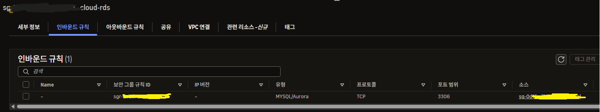
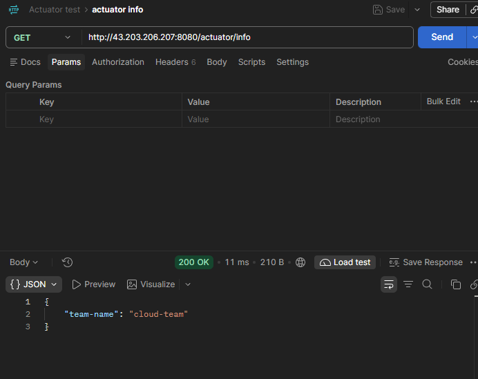

# Cloud Chap Task

## 1. 프로젝트 소개

AWS 클라우드 환경에서 Spring Boot 기반의 팀원 정보 등록 및 조회 API를 구현하고 배포하는 프로젝트입니다.

## 2. 기술 스택

- **Language** : Java 17
- **Framework** : Spring Boot, Spring Web MVC
- **Database** : H2, MySQL 
- **ORM** : Spring Data JPA
- **Library** : Lombok, Validation
- **Logging** : SLF4J
- **Monitoring** : Spring Boot Actuator
- **Build Tool** : Gradle
- **Infrastructure** : AWS VPC, EC2, RDS
- **Version Control** : Git, GitHub
- **Configuration Management** : AWS Parameter Store
- **API Test** : Postman
- **Access Management** : AWS IAM

---

## 3. Lv 0 - AWS 비용 관리

- 월 예산: $100
- 예산 80% 도달 시 이메일 알림 설정

### AWS Budgets 설정


---

## 4. Lv 1 - 인프라 구축 및 애플리케이션 배포

### 4-1. AWS 인프라 구성

- VPC 생성
- Public / Private Subnet 분리
- Public Subnet에 EC2 배치

### 4-2. API 기능 & 테이블 명세서

- [테이블 명세서](https://savory-sort-03c.notion.site/419d2e2ddefa8064b437e544fe1223c5?source=copy_link)
- [팀원 정보 등록](https://savory-sort-03c.notion.site/API-40dd2e2ddefa80c5acd9faa462b73599?source=copy_link)
- [팀원 정보 조회](https://savory-sort-03c.notion.site/API-419d2e2ddefa80a8b4d9cb4d9257843c?source=copy_link)

### 4-3. Profile 분리

| Profile | 데이터베이스 |
| --- | --- |
| local | H2 |
| prod | MySQL |

- 실행 환경별 YAML 설정 분리
- 운영 DB 접속 정보 외부 주입 방식 적용

### 4-4. 로그 전략

- Filter를 활용한 API 요청 INFO 로그 기록
- GlobalExceptionHandler를 활용한 ERROR 로그 및 스택트레이스 기록

### 4-5. EC2 배포 및 검증

- Gradle bootJar를 활용한 JAR 파일 생성
- SCP를 활용한 EC2 파일 전송
- nohup을 활용한 백그라운드 실행
- Postman을 활용한 API 정상 동작 검증

### 4-6. EC2 접속 정보

- Public IP: `3.34.132.101`
- Health Check: `http://3.34.132.101:8080/actuator/health`

### 4-7. Health Check 결과

```json
{
    "groups": [
        "liveness",
        "readiness"
    ],
    "status": "UP"
}
```


---

## 5. LV 2 - RDS 연동 및 운영 환경 구축

### 5-1. AWS 인프라 구성

- RDS MySQL 8.4.11 생성
- Public Subnet을 활용한 DB Subnet Group 구성
- EC2와 RDS의 보안 그룹 분리
- Security Group Chaining 적용

### 5-2. 보안 그룹 설정

| 보안 그룹 | 유형 | 포트 | 접근 허용 대상 |
| --- | --- | --- | --- |
| cloud-rds | MySQL/Aurora | 3306 | EC2 보안 그룹 ID |

- RDS 인바운드 규칙에 EC2 보안 그룹 ID만 허용
- EC2의 불필요한 3306 인바운드 규칙 제거
- SSH Tunnel을 활용한 IntelliJ와 RDS 연결

#### 보안 그룹 설정 결과




### 5-3. Parameter Store 설정

DB 접속 정보와 팀 이름을 외부 설정값으로 관리한다.

| 파라미터 이름 | 유형 | 용도 |
| --- | --- | --- |
| DB_URL | String | RDS JDBC 접속 주소 |
| DB_USERNAME | String | DB 사용자 이름 |
| DB_PASSWORD | String | DB 비밀번호 |
| TEAM_NAME | String | 팀 이름 |

- IAM Role을 활용한 Parameter Store 접근
- AmazonSSMReadOnlyAccess 정책 적용
- Spring Boot 실행 시 Parameter Store 설정값 주입
- 실제 운영 환경에서는 DB_PASSWORD를 SecureString으로 관리 권장


### 5-4. 운영 환경 설정

| 구분 | Local | Prod |
| --- | --- | --- |
| 데이터베이스 | H2 | RDS MySQL |
| ddl-auto | create-drop | validate |
| Parameter Store | 비활성화 | 활성화 |

- 운영 환경의 데이터베이스 스키마 수동 생성
- Parameter Store를 활용한 RDS 연결
- prod Profile을 활용한 EC2 재배포

### 5-5. Actuator Info 확장

- Parameter Store에 저장한 TEAM_NAME 값 연동
- /actuator/info 엔드포인트 활성화

#### API 요청

GET /actuator/info

#### API 응답 (200 OK)

```json
{
    "team-name": "cloud-team"
}
```



### 5-6. 배포 및 테스트 결과

| 테스트 항목 | 결과 |
| --- | --- |
| EC2 prod Profile 실행 | 성공 |
| Parameter Store 설정값 주입 | 성공 |
| RDS MySQL 연결 | 성공 |
| Actuator Health | 성공 |
| Actuator Info | 성공 |
| 팀원 등록 API | 성공 |
| 팀원 단건 조회 API | 성공 |
| RDS 데이터 저장 확인 | 성공 |

### 5-7. EC2 접속 정보

- Public IPv4: `현재 EC2 퍼블릭 IP`
- Health: `http://EC2퍼블릭IP:8080/actuator/health`
- Info: `http://EC2퍼블릭IP:8080/actuator/info`


